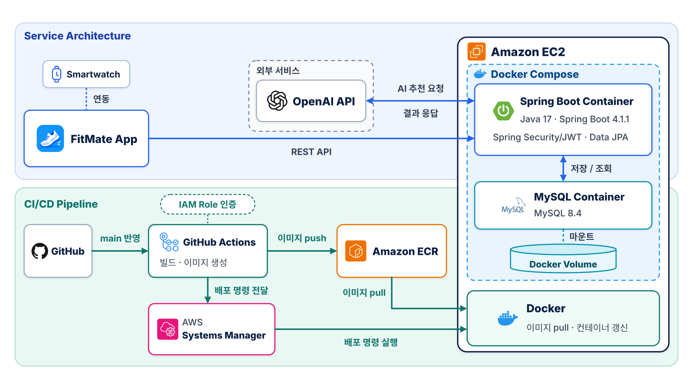
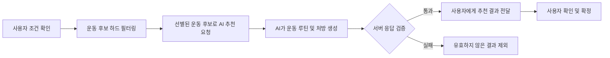

<div align="center">
<h1>FitMate 🏋️</h1>

<h3>운동은 나에게 맞아야 하니까</h3>

<p><strong>Fitness Should Fit You</strong></p>
<p>AI 기반 개인 맞춤형 운동 관리 서비스</p>

<!-- 대표 이미지 삽입 위치: 아래 예시의 경로를 실제 이미지 경로로 바꾸고 주석을 해제하세요. -->
<!--  -->

<p>
  <a href="https://github.com/fitmate-team/frontend">Frontend</a> |
  <a href="https://github.com/fitmate-team/backend">Backend</a>
</p>

<!-- 시연 영상 링크 추가 위치: <a href="영상_URL">Demo Video</a> -->

</div>

## ✨ 주요 기능

### 1. 맞춤형 루틴 만들기

**AI에게 맡기기**

운동할 요일과 시간, 환경을 설정하면 AI가 개인의 목표와 운동 수준에 맞춰 주간 루틴을 생성합니다. 운동 종목과 순서, 중량과 반복 횟수 등을 제안하고 추천 이유와 예상 소요 시간을 함께 제공합니다. 사용자는 매일 어떤 운동을 얼마나 해야 할지 정하는 부담을 줄일 수 있습니다.

<!-- 이미지: 조건 설정 화면 → AI 주간 루틴 결과 화면, 2장 -->

**AI와 함께 만들기**

원하는 운동을 직접 선택하면서 필요한 단계에서 AI의 추천을 받을 수 있습니다. 자신의 운동 기록을 참고한 운동량 추천을 활용하고, 완성한 루틴의 주요 운동 부위와 예상 소요 시간을 확인합니다.

<!-- 이미지: 운동 선택 화면 → 운동량 설정 화면, 필요하면 완성된 루틴 화면 추가 -->

### 2. 상황에 맞게 루틴 변경하기

**당일 재추천**은 오늘 운동할 장소나 가능한 시간이 달라졌을 때 사용합니다. 유지 가능한 운동은 남기고 필요한 종목과 운동량을 조정합니다. 사용자는 AI의 변경안을 적용하거나 기존 루틴을 직접 수정할 수 있습니다.

**주간 재생성**은 이미 수행한 기록을 보존하면서 남은 운동 일정을 다시 구성합니다. AI에게 재생성을 맡기거나 직접 구성하는 방식을 선택할 수 있어, 일정이 바뀌어도 계획 전체를 처음부터 작성할 필요가 없습니다.

<!-- 이미지: 당일 조건 변경 화면 → 재추천 결과 비교 화면, 2장 -->
<!-- 주간 재생성 화면을 추가할 경우 남은 요일을 선택하는 화면 사용 -->

### 3. 계획한 운동 진행하기

운동 가이드를 확인하고 계획한 순서에 따라 운동을 진행합니다. 세트 진행 상황과 운동 및 휴식 시간을 관리하며, 완료한 세트 수와 수행 시간을 기록합니다. 앱과 스마트워치 연동으로 운동 진행을 확인할 수 있습니다.

<!-- 이미지: 운동 진행 화면 / 휴식 타이머 화면, 2장 -->
<!-- 워치 화면은 필요할 경우 이 위치에 작은 이미지로 함께 배치 -->

### 4. 기록과 성장 확인하기

날짜별 운동 결과와 월별 운동 횟수, 운동 시간을 조회할 수 있습니다. 신체 지표와 운동별 중량 변화, 출석률을 확인하며 자신의 운동 과정을 점검합니다.

<!-- 이미지: 운동 기록 달력 화면 / 성장 분석 화면, 1~2장 -->

### 5. 운동 결과에 맞춰 운동량 조정하기

운동을 마치면 실제 수행량과 체감 난이도 등을 바탕으로 운동별 난이도를 분석합니다. AI는 너무 쉽거나 어려웠던 운동의 중량과 운동량을 어떻게 바꿀지 제안합니다.

사용자가 조정안을 선택하면, 이후 자동으로 생성하거나 재생성하는 루틴에 같은 종목이 포함될 때 반영합니다. 실제 운동 경험을 다음 계획에 활용해 자신에게 맞는 운동 강도를 찾아갈 수 있습니다.

<!-- 이미지: 운동 분석 결과 화면 → AI 운동량 조정 제안 화면, 2장 -->

## 🛠️ 기술 스택과 아키텍처

### 기술 스택

| 구분 | 기술 |
| --- | --- |
| 언어 / 프레임워크 | Java 17, Spring Boot 4.1.1 |
| 데이터 | MySQL 8.4, Spring Data JPA |
| 인증 | Spring Security, JWT |
| AI | OpenAI API |
| 빌드 | Gradle Wrapper |
| API 문서 | Swagger / OpenAPI |
| 컨테이너 | Docker, Docker Compose |
| CI/CD / 인프라 | GitHub Actions, AWS EC2, ECR, SSM |

의존성과 버전은 [build.gradle](build.gradle), 컨테이너 구성은 [compose.yml](compose.yml)에서 확인할 수 있습니다.

### 시스템 구성과 배포

Spring Boot 서버와 MySQL은 EC2에서 각각 Docker 컨테이너로 실행합니다. 서버는 앱의 요청을 처리하고, 루틴 생성과 운동량 추천에 OpenAI API를 사용합니다.

<p align="center">
  
</p>


GitHub Actions로 코드를 빌드하며, `main` 브랜치에 변경 사항이 반영되면 Docker 이미지를 ECR에 업로드합니다. SSM으로 EC2에 배포 명령을 전달하고 Docker Compose로 서버 컨테이너를 갱신합니다.

[CI 설정](.github/workflows/ci.yml) / [CD 설정](.github/workflows/cd.yml)

### AI 추천 구조



AI에 추천을 요청하기 전에 서버가 운동 환경과 개인 조건에 맞는 종목을 선별합니다. 생성된 결과는 허용된 운동인지, 시간과 운동량 형식 등 기능별 규칙을 지키는지 다시 검사합니다. 서버는 추천 범위와 결과의 유효성을 관리하고, AI는 해당 정보를 바탕으로 운동 계획을 구성합니다.

## 🚀 실행 방법

JDK 17과 MySQL 8.4를 준비합니다. 아래는 로컬 MySQL과 Gradle Wrapper로 서버를 실행하는 방법입니다.

<details>
<summary>로컬 실행 방법 펼치기</summary>

### 1. 저장소 복제

```bash
git clone https://github.com/fitmate-team/backend.git
cd backend
```

### 2. 데이터베이스 생성

로컬 MySQL을 실행한 뒤 비어 있는 `fitmate` 데이터베이스를 준비합니다.

```bash
mysql -h 127.0.0.1 -P 3306 -u root -p \
  -e "CREATE DATABASE IF NOT EXISTS fitmate CHARACTER SET utf8mb4;"
```

기본 로컬 설정은 `localhost:3306`의 `fitmate` DB와 `root` 계정을 사용합니다. 다른 계정을 사용하는 경우 [application-local.yml](src/main/resources/application-local.yml)을 수정합니다.

### 3. 환경변수 설정

환경변수는 IDE의 실행 설정이나 터미널에 등록합니다. 다음은 macOS / Linux 터미널 기준 예시이며, MySQL 클라이언트와 OpenSSL 명령을 사용합니다.

| 변수 | 설명 |
| --- | --- |
| `DB_PASSWORD` | 로컬 MySQL `root` 계정 비밀번호 |
| `JWT_SECRET` | 32바이트 이상의 임의 키를 Base64로 인코딩한 값 |
| `OPENAI_API_KEY` | AI 기능 호출에 사용할 API 키 |

```bash
export DB_PASSWORD='YOUR_LOCAL_MYSQL_ROOT_PASSWORD'
export JWT_SECRET="$(openssl rand -base64 32)"
export OPENAI_API_KEY='YOUR_OPENAI_API_KEY'
```

`JWT_SECRET`은 최초 설정 시 생성하고 이후 실행에서도 같은 값을 사용합니다. 비밀번호와 API 키는 저장소에 커밋하지 않습니다. `.env`에 값을 작성한 경우에도 서버 실행 환경에 별도로 등록해야 합니다.

### 4. 서버 실행

환경변수를 등록한 터미널에서 실행합니다.

```bash
chmod +x gradlew
./gradlew bootRun --args='--spring.profiles.active=local'
```

로컬 설정의 `ddl-auto: update`에 따라 첫 실행 시 필요한 테이블이 생성됩니다.

### 5. 초기 운동 데이터 입력

첫 서버 기동이 완료되면 별도 터미널에서 저장소 루트로 이동하여 초기 데이터를 입력합니다.

```bash
mysql --default-character-set=utf8mb4 \
  -h 127.0.0.1 -P 3306 -u root -p fitmate \
  < src/main/resources/db/seed/Master_seed_v0.6.2.sql
```

초기 데이터는 새 로컬 DB를 준비할 때 적용합니다. 기존 데이터를 보관 중인 DB에는 내용을 확인하지 않고 실행하지 않습니다.

### 6. API 문서 확인

서버 실행 후 [로컬 Swagger](http://localhost:8080/swagger-ui.html)에서 API 문서를 확인할 수 있습니다.

공통 설정은 [application.yml](src/main/resources/application.yml)에 있습니다. 저장소의 `compose.yml`은 ECR의 배포 이미지를 사용하므로 위 로컬 실행 절차와 구분합니다.

</details>

## 👥 팀원

<!-- 팀원 이름, GitHub 주소, 실제 담당 기능을 입력하고 인원수에 맞게 행을 추가한다. -->

| 이름 | 담당 기능 | GitHub |
| --- | --- | --- |
| 김나영 | AI, Backend | nayeong29 |
| 김민서 | Backend | Linaeformin |
| 김도연 | Frontend | kimdoyeon1234 |
| 김지아 | Frontend | Lemon0610 |
